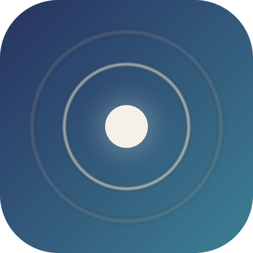
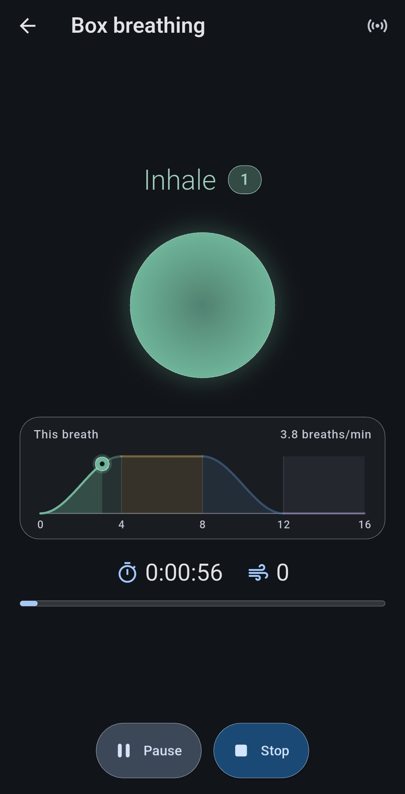
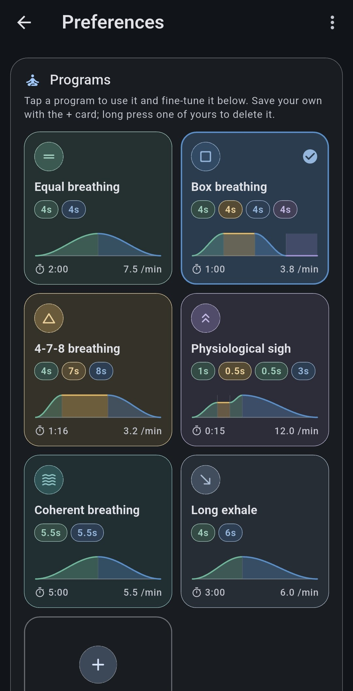
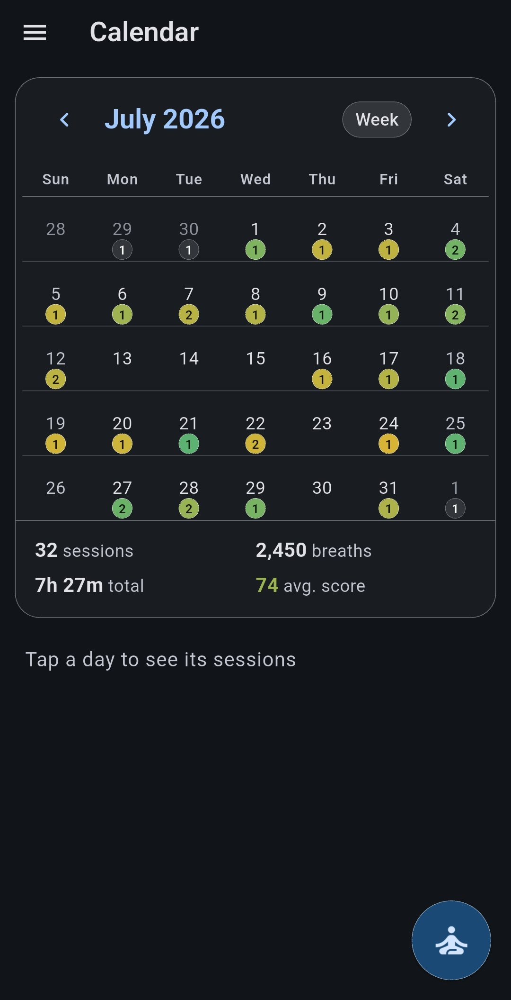
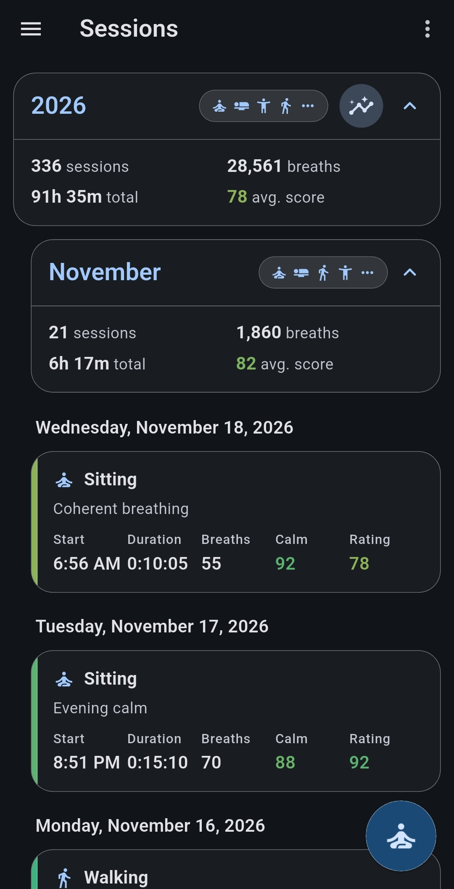
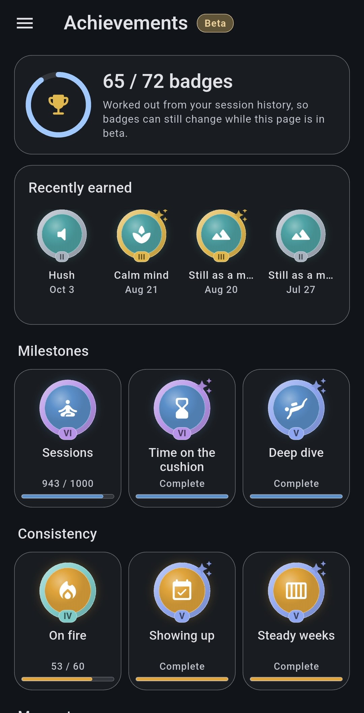

<p align="center">
  
</p>

<h1 align="center">Lucid</h1>

<p align="center">
  A calm, private breathing and meditation timer for Android.<br>
  Based on <a href="https://github.com/jithware/brethap">Brethap</a> by Jithware.
</p>

<p align="center">
  <a href="https://github.com/Ignophi/lucid/actions/workflows/flutter.yml"></a>
  <a href="https://github.com/Ignophi/lucid/releases/latest"></a>
  <a href="LICENSE"></a>
</p>

Pick a breathing program, follow the circle and the wave, then rate the
session. Lucid keeps your log, shows how your practice grows, and keeps
everything on your phone: no account, no ads, no tracking.

> Lucid is a fork of [Brethap](https://github.com/jithware/brethap), redesigned
> and extended. Thanks to Jithware for the original app. See
> [Differences from Brethap](#differences-from-brethap).

## Screenshots

<table>
  <tr>
    <td></td>
    <td></td>
    <td></td>
    <td></td>
  </tr>
  <tr>
    <td align="center">Breathe</td>
    <td align="center">Programs</td>
    <td align="center">Your session</td>
    <td align="center">Calendar</td>
  </tr>
  <tr>
    <td></td>
    <td></td>
    <td></td>
    <td></td>
  </tr>
  <tr>
    <td align="center">Sessions</td>
    <td align="center">Analytics</td>
    <td align="center">Year overview</td>
    <td align="center">Achievements</td>
  </tr>
</table>

## Features

**Breathe**
- Six programs: Equal, Box, 4-7-8, Physiological sigh, Coherent and Long
  exhale, each shown with its breathing wave. Adjust any of them and save your
  own.
- A breathing circle that changes color with each part of the breath, a live
  wave of the current breath, and the seconds left, time left and breath count.
- Pause and resume. Sessions keep time with the screen off or another app
  open, with a countdown in the notification.
- Optional tones, vibration and spoken cues.

**Track**
- Review each session: type (Sitting, Lying down, Walking, Body scan, Other),
  a 0–100 rating and a note.
- Calendar with days colored by score, and a session log grouped by year and
  month.
- Analytics for 30 days, a year or all time: totals, average score, best
  streak, minutes per day, month and year, a year overview, time of day, day
  of the week and type.
- Achievements (beta): 18 achievements with 72 badges for milestones, streaks
  and special moments, worked out from your history.

**Measure** (optional)
- Motion: stillness, position, steps and breaths, from how the phone moves.
- Sound, off by default: how quiet the room was. Sound becomes loudness numbers
  as it comes in; nothing is recorded.
- A calm score per session, and how well your movement fits the session type.

**Keep**
- Reminders on days you have not meditated yet, with a daily goal.
- Automatic backup after each session to `Download/Lucid`, one CSV file per
  month.
- CSV import and export. Lucid also reads Brethap exports.
- Light and dark theme.

## Differences from Brethap

**New**
- Session reviews, analytics, measurements, achievements, reminders and
  automatic backup.
- Breathing wave, a color for each part of the breath, pause and resume.
- Coherent and Long exhale programs, and your own saved programs.

**Changed**
- New name, icon and app ID (`io.github.ignophi.lucid`), so it installs next
  to Brethap.
- New Material 3 design: calm blue, thin outlines, side menu, Calendar as the
  home screen.
- The timer follows the clock and runs in a foreground service, so it no
  longer stops when the screen turns off or another app is open.
- Presets and saved preference slots became programs. Preferences is
  redesigned around a wave preview and quick duration choices.
- Import and export use any file you pick, instead of one fixed backup file.
- Hold tones are silent by default.
- Updated to Flutter 3.41 with fewer dependencies.

**Removed**
- Wear OS support.
- Web and iOS builds: Lucid is Android only.
- Translations: English only for now (Brethap had 9 languages). Help is
  welcome.

## Download

- **GitHub**: the APK of each version, with its SHA-256 checksum, is on the
  [Releases](https://github.com/Ignophi/lucid/releases) page.
- **F-Droid and IzzyOnDroid**: planned.

Lucid needs Android 7.0 or newer.

## Privacy

Lucid sends nothing anywhere. Your sessions, settings and measurements stay on
your phone and in the backups it saves to your Download folder. The microphone
is only used if you turn on sound measurements, and only during a session. See
[PRIVACY.md](PRIVACY.md).

## Build

Requires Flutter 3.41.2 (see `.fvmrc`) and Java 17. With an Android phone
connected (USB debugging on):

```bash
flutter pub get          # download dependencies, generate texts
flutter test             # run the tests
flutter run --release    # build and install on the phone
```

To try Lucid with a full history, import
[docs/demo/lucid-demo-sessions.csv](docs/demo/lucid-demo-sessions.csv)
(Sessions > ⋮ > Import): three years of made-up sessions, used for the
screenshots. Signed releases are explained in
[docs/RELEASING.md](docs/RELEASING.md).

## Contributing

Bug reports and ideas are welcome in
[Issues](https://github.com/Ignophi/lucid/issues). Please run
`flutter analyze` and `flutter test` before opening a pull request.

## License

Lucid is a modified version of [Brethap](https://github.com/jithware/brethap)
by Jithware. Like Brethap, it is free software under the
[GNU General Public License v3](LICENSE).
