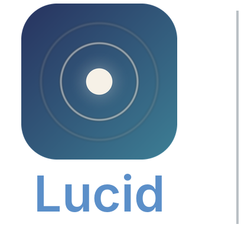
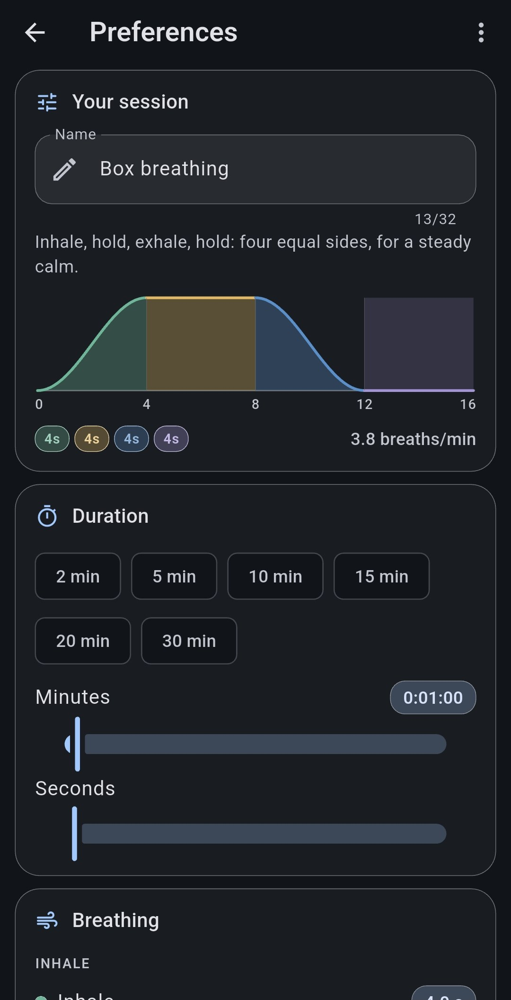
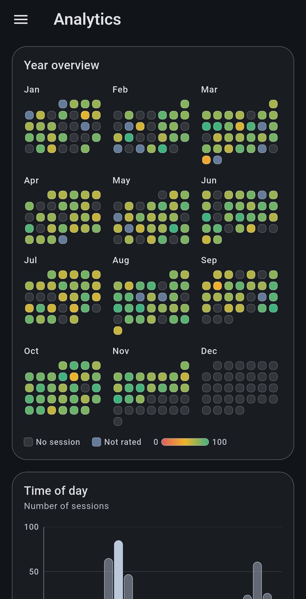

**A clean, free and private meditation app for Android.**

 No account &nbsp;&nbsp;
 No ads &nbsp;&nbsp;
 No tracking &nbsp;&nbsp;
 Stays on your phone

<a href="https://github.com/Ignophi/lucid/releases/latest"></a>
<a href="https://github.com/Ignophi/lucid/actions/workflows/flutter.yml"></a>

<a href="LICENSE"></a>
<a href="https://github.com/jithware/brethap"></a>

<br clear="left">

## Features

<table>
  <tr>
    <th><a href="docs/FEATURES.md#breathe"> Breathe</a></th>
    <th><a href="docs/FEATURES.md#programs"> Programs</a></th>
    <th><a href="docs/FEATURES.md#your-session"> Your session</a></th>
    <th><a href="docs/FEATURES.md#calendar"> Calendar</a></th>
  </tr>
  <tr>
    <td><a href="docs/FEATURES.md#breathe"></a></td>
    <td><a href="docs/FEATURES.md#programs"></a></td>
    <td><a href="docs/FEATURES.md#your-session"></a></td>
    <td><a href="docs/FEATURES.md#calendar"></a></td>
  </tr>
  <tr>
    <th><a href="docs/FEATURES.md#sessions"> Sessions</a></th>
    <th><a href="docs/FEATURES.md#analytics"> Analytics</a></th>
    <th><a href="docs/FEATURES.md#year-overview"> Year overview</a></th>
    <th><a href="docs/FEATURES.md#achievements"> Achievements</a></th>
  </tr>
  <tr>
    <td><a href="docs/FEATURES.md#sessions"></a></td>
    <td><a href="docs/FEATURES.md#analytics"></a></td>
    <td><a href="docs/FEATURES.md#year-overview"></a></td>
    <td><a href="docs/FEATURES.md#achievements"></a></td>
  </tr>
</table>

<a href="docs/FEATURES.md#measurements"> Measurements</a> &nbsp;&nbsp;
<a href="docs/FEATURES.md#reminders"> Reminders</a> &nbsp;&nbsp;
<a href="docs/FEATURES.md#backup"> Automatic backup</a> &nbsp;&nbsp;
<a href="docs/FEATURES.md#backup"> Import and export</a>

<sub>Tap a feature for details.</sub>

## Download

<a href="https://github.com/Ignophi/lucid/releases/latest"></a>

<sub>F-Droid and IzzyOnDroid are planned.</sub>

<details>
<summary><b>What's different from Brethap</b></summary>
<br>

Lucid is a fork of [Brethap](https://github.com/jithware/brethap) by Jithware.

- **New:** session reviews, analytics, measurements, achievements, reminders,
  automatic backup, the breathing wave, pause, your own programs.
- **Changed:** name, icon, app ID and design. The timer keeps running with the
  screen off. Presets and saved slots became programs. Hold tones are silent
  by default.
- **Removed:** Wear OS, web and iOS builds, translations (English only for
  now).

</details>

<details>
<summary><b>Build it yourself</b></summary>
<br>

Flutter 3.41.2 (see `.fvmrc`) and Java 17, with a phone connected:

```bash
flutter pub get          # download dependencies, generate texts
flutter test             # run the tests
flutter run --release    # build and install on the phone
```

To try it with three years of made-up sessions, import
[docs/demo/lucid-demo-sessions.csv](docs/demo/lucid-demo-sessions.csv)
(Sessions > ⋮ > Import). Signed releases: [docs/RELEASING.md](docs/RELEASING.md).

</details>

<details>
<summary><b>Privacy</b></summary>
<br>

Lucid sends nothing anywhere. Sessions, settings and measurements stay on your
phone and in the backups it saves to your Download folder. The microphone is
only used if you turn on sound measurements. See [PRIVACY.md](PRIVACY.md).

</details>

---

<sub>Based on [Brethap](https://github.com/jithware/brethap) by Jithware ·
Free software under the [GPL-3.0](LICENSE) · Ideas and bugs:
[Issues](https://github.com/Ignophi/lucid/issues)</sub>
