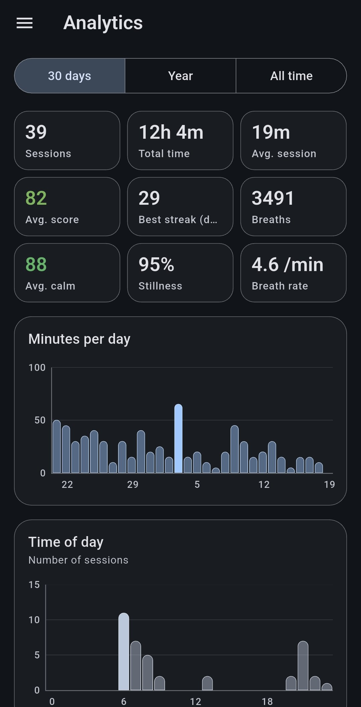

**A feature-rich, private and free meditation app for Android.**

 Local &nbsp;&nbsp;
 No account &nbsp;&nbsp;
 No ads &nbsp;&nbsp;
 No tracking

<a href="https://github.com/Ignophi/lucid/releases/latest"></a>
<a href="https://github.com/Ignophi/lucid/actions/workflows/flutter.yml"></a>

<a href="LICENSE"></a>

<br clear="left">

> Lucid is a fork of [Brethap](https://github.com/jithware/brethap), redesigned
> and extended. Thanks to Jithware for the original app. See
> [Differences from Brethap](#differences-from-brethap).

##  Features

Tap a feature for details.

<table>
  <tr>
    <th><a href="docs/FEATURES.md#breathe"> Breathe</a></th>
    <th><a href="docs/FEATURES.md#programs"> Programs</a></th>
    <th><a href="docs/FEATURES.md#your-session"> Your session</a></th>
    <th><a href="docs/FEATURES.md#calendar"> Calendar</a></th>
  </tr>
  <tr>
    <td><a href="docs/FEATURES.md#breathe"></a></td>
    <td><a href="docs/FEATURES.md#programs"></a></td>
    <td><a href="docs/FEATURES.md#your-session"></a></td>
    <td><a href="docs/FEATURES.md#calendar"></a></td>
  </tr>
  <tr>
    <th><a href="docs/FEATURES.md#sessions"> Sessions</a></th>
    <th><a href="docs/FEATURES.md#analytics"> Analytics</a></th>
    <th><a href="docs/FEATURES.md#year-overview"> Year overview</a></th>
    <th><a href="docs/FEATURES.md#achievements"> Achievements</a></th>
  </tr>
  <tr>
    <td><a href="docs/FEATURES.md#sessions"></a></td>
    <td><a href="docs/FEATURES.md#analytics"></a></td>
    <td><a href="docs/FEATURES.md#year-overview"></a></td>
    <td><a href="docs/FEATURES.md#achievements"></a></td>
  </tr>
</table>

 **[Measurements](docs/FEATURES.md#measurements)**: stillness, breaths and how quiet the room was, from the phone's own sensors. Optional.<br>
 **[Reminders](docs/FEATURES.md#reminders)**: a gentle nudge on days you have not meditated yet.<br>
 **[Automatic backup](docs/FEATURES.md#backup)**: after each session, everything is saved to `Download/Lucid`.<br>
 **[Import and export](docs/FEATURES.md#backup)**: your sessions as CSV files, including exports from Brethap.

##  Download

<a href="https://github.com/Ignophi/lucid/releases/latest"></a>


F-Droid and IzzyOnDroid are coming soon.

## <a name="differences-from-brethap"></a> Differences from Brethap

- **New:** session reviews, analytics, measurements, achievements, reminders,
  automatic backup, the breathing wave, pause, your own programs.
- **Changed:** name, icon, app ID and design. The timer keeps running with the
  screen off. Presets and saved slots became programs. Hold tones are silent
  by default.
- **Removed:** Wear OS, web and iOS builds, translations (English only for
  now).

##  Privacy

Lucid sends nothing anywhere. Your sessions, settings and measurements stay on
your phone and in the backups it saves to your Download folder. The microphone
is only used if you turn on sound measurements; sound becomes loudness numbers
as it comes in and is never stored. See [PRIVACY.md](PRIVACY.md).

##  Build it yourself

Requires Flutter 3.41.2 (see `.fvmrc`) and Java 17. With an Android phone
connected (USB debugging on):

```bash
flutter pub get          # download dependencies, generate texts
flutter test             # run the tests
flutter run --release    # build and install on the phone
```

To try Lucid with a full history, import
[docs/demo/lucid-demo-sessions.csv](docs/demo/lucid-demo-sessions.csv)
(Sessions > ⋮ > Import): three years of made-up sessions, used for the
screenshots. Signed releases and the automatic APK builds are explained in
[docs/RELEASING.md](docs/RELEASING.md).

<details>
<summary>Project layout</summary>
<br>

| Path | What it is |
|---|---|
| `lib/home_widget.dart`, `lib/breathing.dart`, `lib/breath_wave.dart` | Meditation screen, breathing timing, breathing wave |
| `lib/programs.dart`, `lib/preferences_widget.dart` | Programs and the Preferences screen |
| `lib/session_measure.dart`, `lib/session_recorder.dart` | Sensor recording and analysis |
| `lib/achievements.dart`, `lib/achievements_widget.dart` | Achievements |
| `lib/session_files.dart`, `lib/session_csv.dart` | Import, export, automatic backup |
| `lib/analytics.dart`, `lib/analytics_widget.dart`, `lib/charts.dart` | Analytics |
| `android/app/src/main/kotlin/…/SessionService.kt` | Keeps sessions running with the screen off |
| `lib/l10n/app_en.arb` | All texts |
| `fastlane/metadata/android/` | Store listing (used by F-Droid) |

</details>

##  Contributing

Bug reports and ideas are welcome in
[Issues](https://github.com/Ignophi/lucid/issues). Please run
`flutter analyze` and `flutter test` before opening a pull request.

##  License

Lucid is a modified version of [Brethap](https://github.com/jithware/brethap)
by Jithware. Like Brethap, it is free software under the
[GNU General Public License v3](LICENSE).
