# Lucid features

[← Back](../README.md)

## Breathe

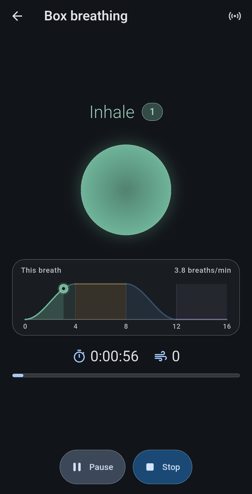

- A circle that grows and shrinks, with its own color for each part of the
  breath: inhale, hold, exhale, hold.
- A live wave of the current breath, with the seconds left, time left and
  breath count.
- Pause and resume.
- Keeps time with the screen off or another app open. The notification counts
  down.
- Optional tones, vibration and spoken cues.

 

## Programs

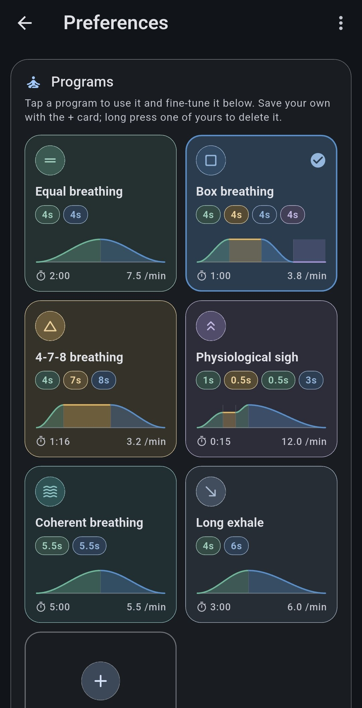

- Six programs: Equal, Box, 4-7-8, Physiological sigh, Coherent and Long
  exhale.
- Each card shows the seconds of each part, the breathing wave, the length and
  the breaths per minute.
- Save your own with the **+** card. Long press one of yours to delete it.

 

## Your session

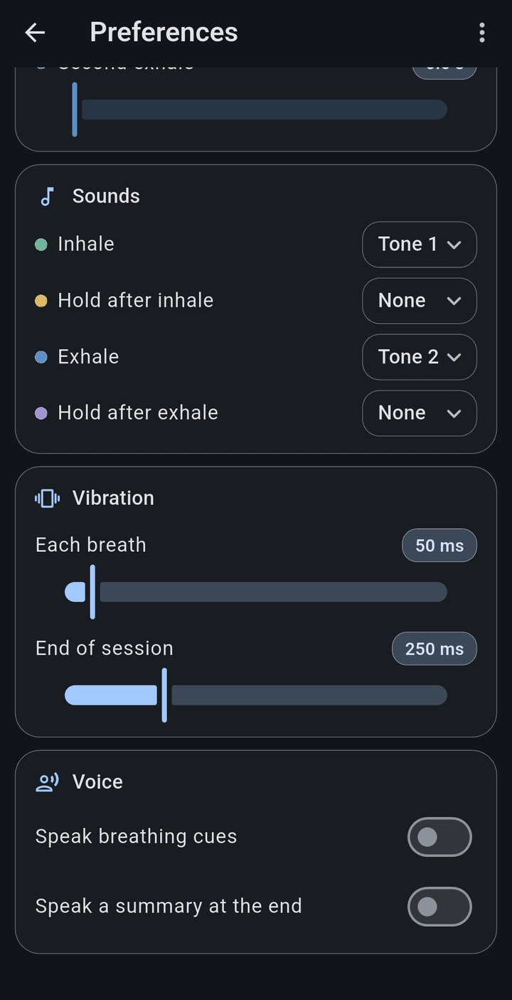
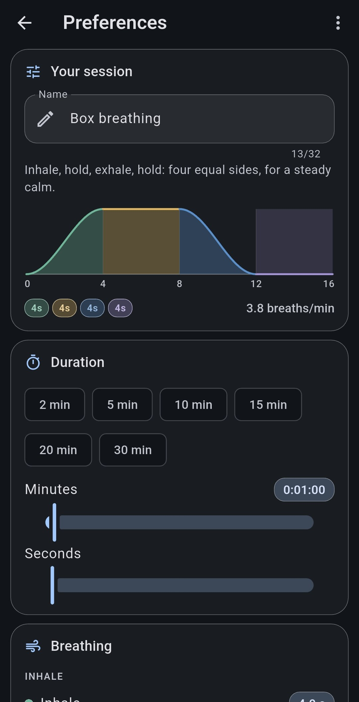

- Name, duration (quick choices or sliders) and the length of each part of the
  breath.
- The wave updates as you change it.
- A tone for each part of the breath, vibration and spoken cues. Holds are
  silent by default.

 

## Calendar

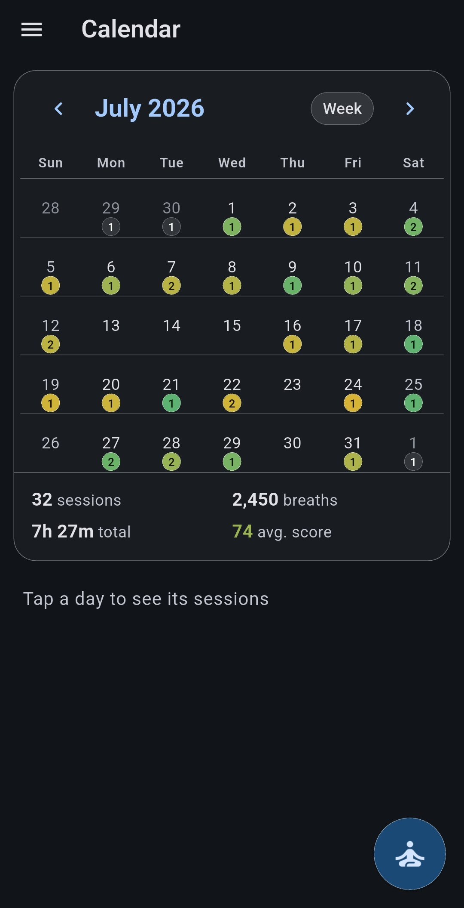

- Each day shows its number of sessions, colored by rating.
- Month or week view, with sessions, time, breaths and average score.
- Tap a day to see its sessions.

 

## Sessions

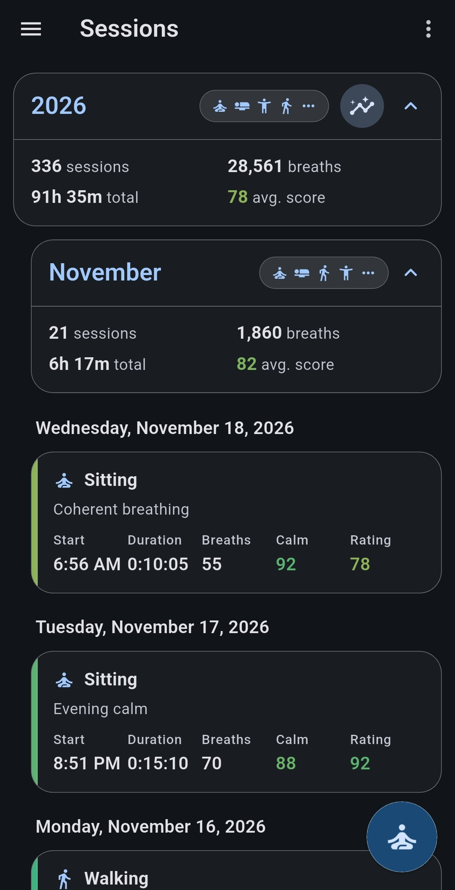

- Every session with its type, program, start, duration, breaths, calm and
  rating.
- Grouped by year and month, with totals.
- After each session: pick the type (Sitting, Lying down, Walking, Body scan,
  Other), rate it 0–100 and add a note.

 

## Analytics

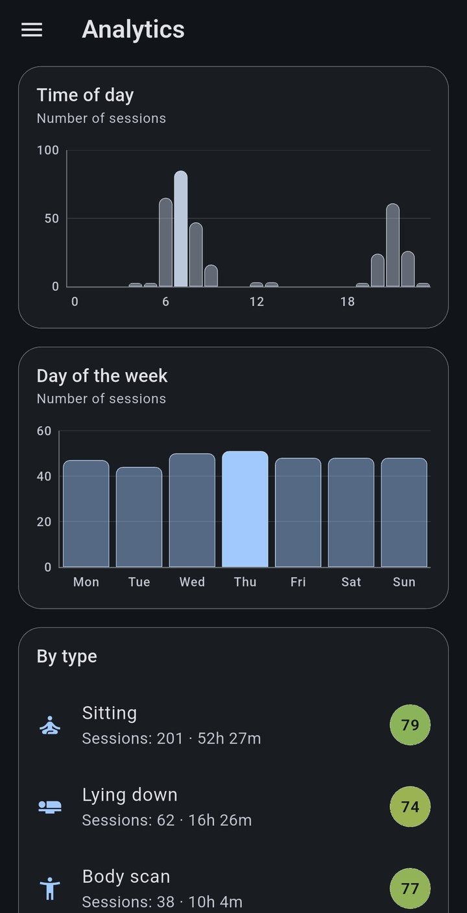
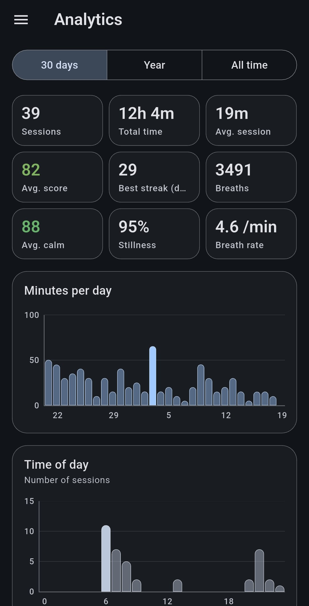

- 30 days, a year or all time.
- Sessions, time, average score and calm, best streak, breaths, stillness and
  breath rate.
- Minutes per day, month and year, time of day, day of the week and each type.

 

## Year overview

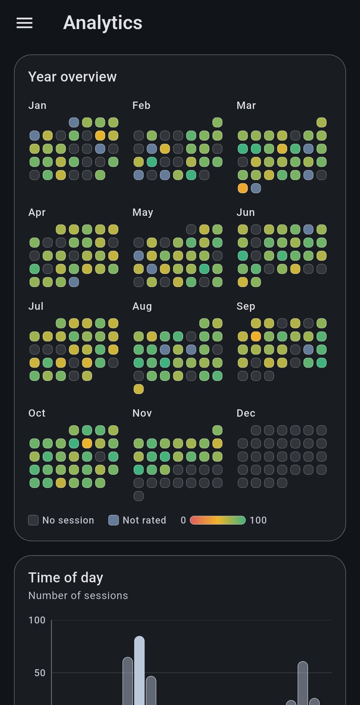

- Every day of the year at a glance, colored by rating.
- Blue for sessions without a rating, grey for days without a session.

 

## Achievements

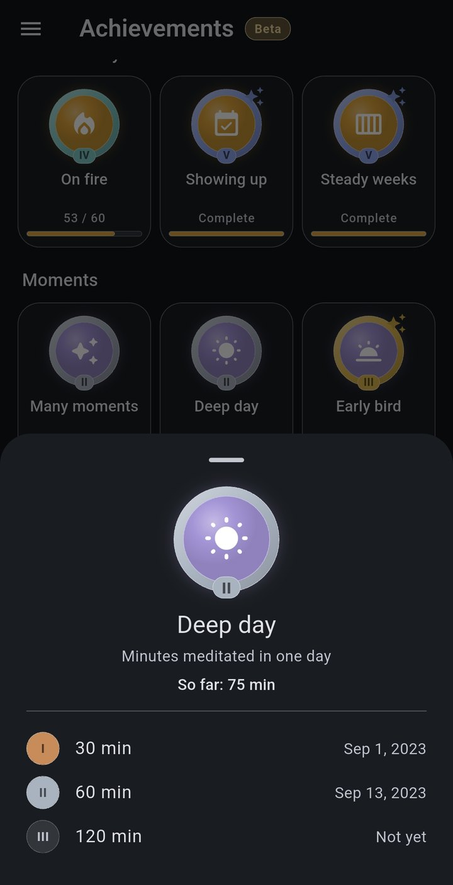
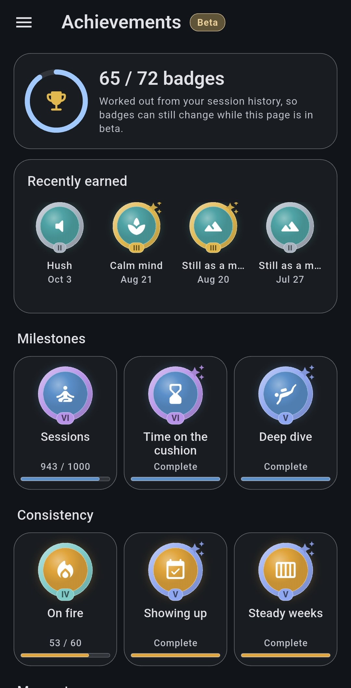

- 18 achievements with 72 badges: milestones, streaks, special moments,
  practice and mindfulness.
- Each badge shows your progress and the date you earned each level.
- Worked out from your history, so past sessions count too.
- A small celebration when you earn one.
- In beta: badges may still change.

 

## Measurements

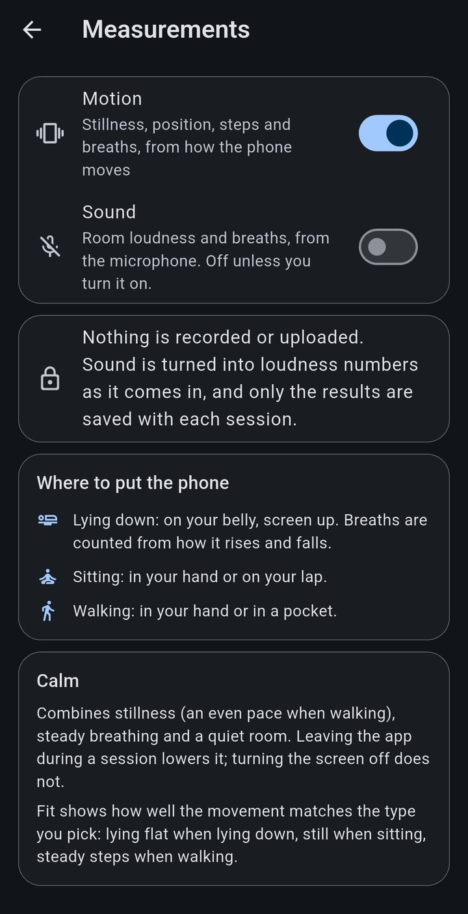

- Optional, with the phone's own sensors.
- **Motion** (on by default): stillness, position, steps and breaths.
- **Sound** (off by default): how quiet the room was. Nothing is recorded or
  uploaded.
- A calm score per session, and how well your movement fits the session type.
- Lying down: phone on your belly. Sitting: in your hand or lap. Walking: in
  your hand or pocket.

 

## Reminders

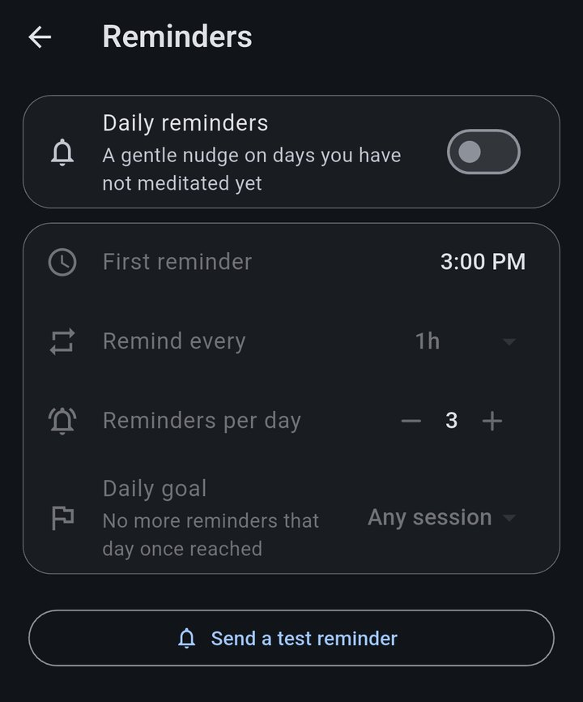

- A gentle nudge on days you have not meditated yet.
- Choose the first time, how often, how many per day, and a daily goal after
  which they stop.

 

## Backup

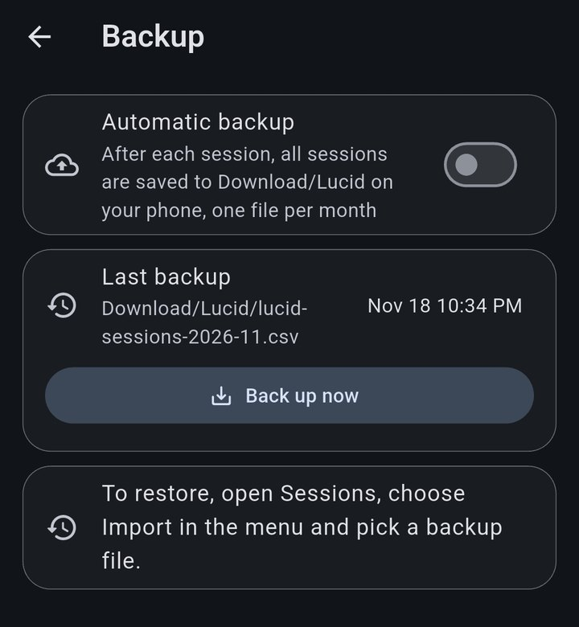

- After each session, all sessions are saved to `Download/Lucid`, one file per
  month.
- Back up now at any time.
- Import and export CSV files from Sessions. Lucid also reads Brethap exports.

 

## Also

- Light and dark theme, following your phone.
- English only for now. Translations are welcome.

[← Back](../README.md)
